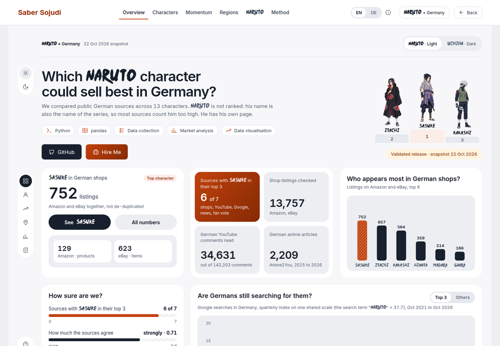
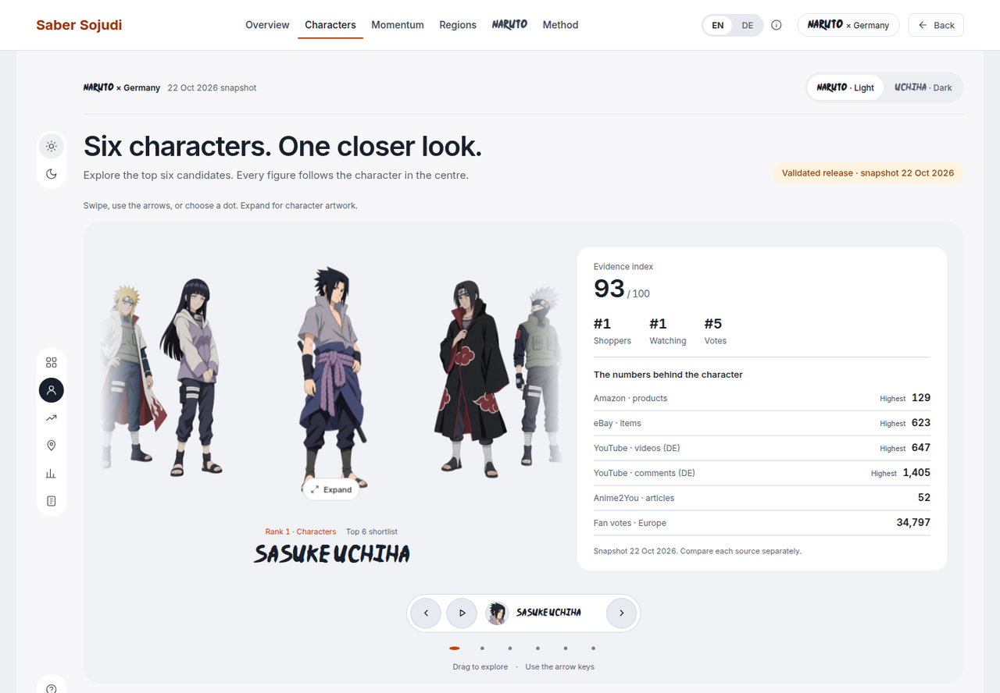
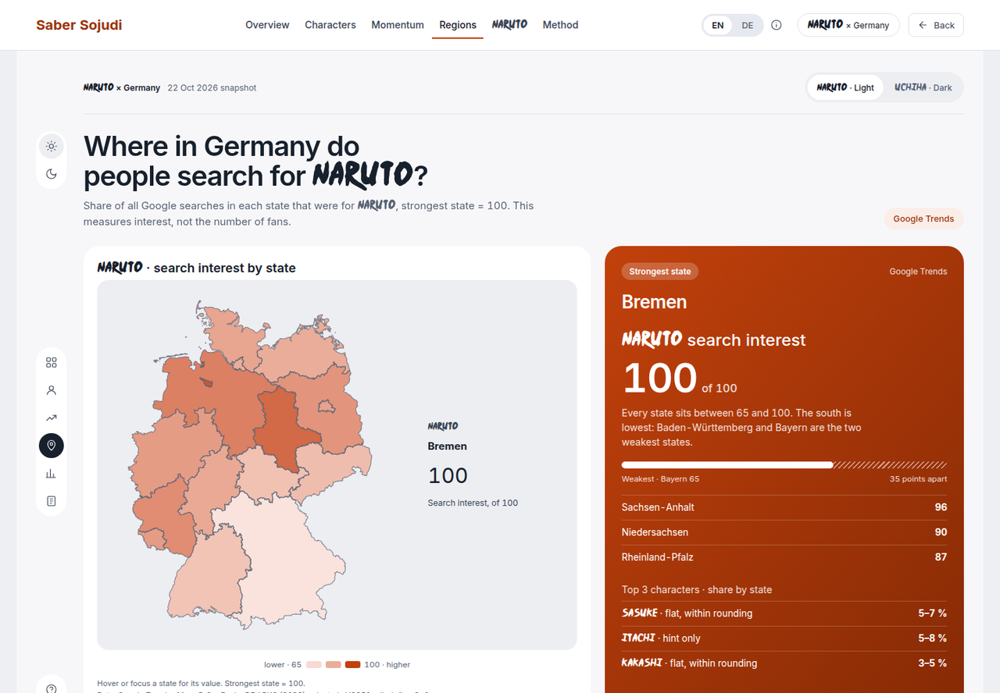
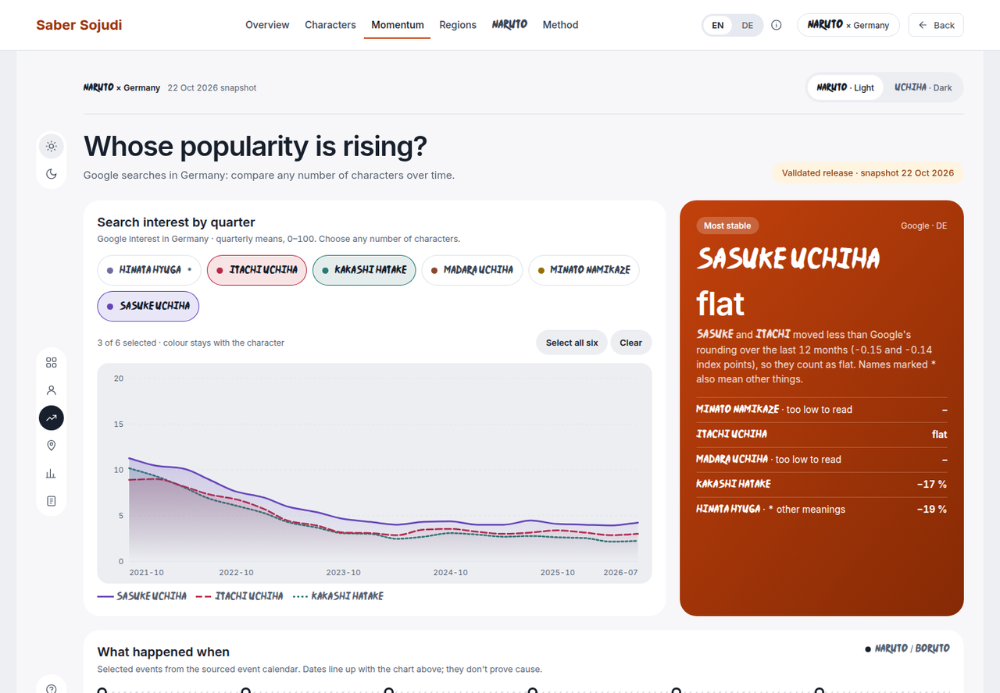
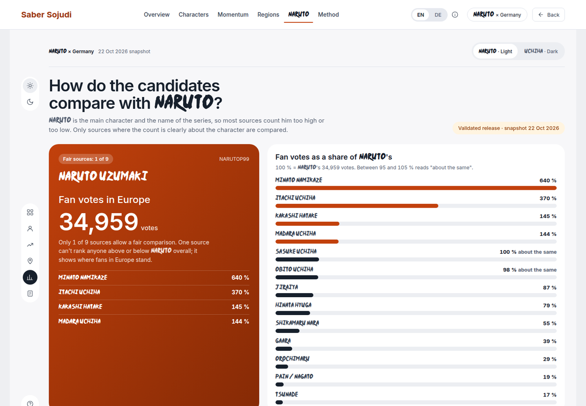
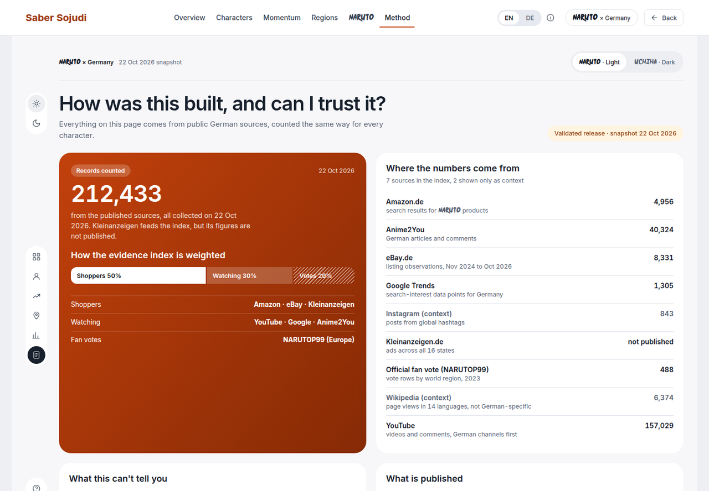
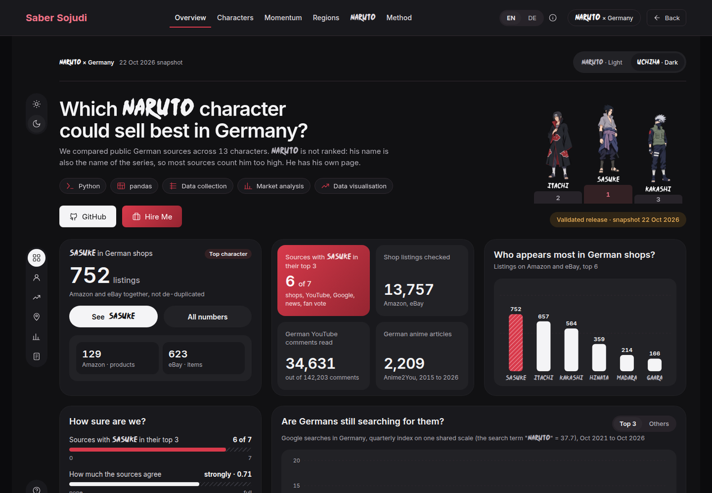

# Naruto × Germany

**Which Naruto character could sell best in Germany?** A plain-language, bilingual (German/English) dashboard that ranks 13 Naruto characters on public German market signals and shows how sure the answer is.

**Live:** [sabersojudi.com/naruto-germany](https://sabersojudi.com/naruto-germany/)



## What it shows

| Screen | Question |
|---|---|
| Overview | Who are the strongest candidates, and how sure are we? |
| Characters | What does the evidence say about one character? |
| Momentum | Whose Google search interest is rising or falling? |
| Regions | Where in Germany do people search for Naruto? |
| Naruto | How do the candidates compare with Naruto himself, on fair sources only? |
| Method | How was this built, and what can't it tell you? |

**Result (snapshot 22 Oct 2026):** Sasuke Uchiha (evidence index 93), Itachi Uchiha (89) and Kakashi Hatake (83). The same three stay on top when any one of the 7 sources is removed (7 of 7 runs) and under 3 other weightings; the sources agree strongly (Kendall's W 0.71).

| Characters | Regions |
|---|---|
|  |  |
| **Momentum** | **Naruto compared with the candidates** |
|  |  |
| **Method** | **Dark theme** |
|  |  |

## How the evidence index works

- **Sources in the index (7):** Amazon.de, eBay.de and Kleinanzeigen (shoppers), YouTube, Google Trends and Anime2You (watching), the official NARUTOP99 fan vote (votes). Wikipedia and Instagram are shown as context only, because they are not specific to Germany.
- **Weights:** shoppers 50 %, watching 30 %, votes 20 %. Each character is ranked within each source; ranks are averaged per lens and combined into an index from 0 to 100.
- **Accuracy:** keyword matches were checked by hand on a sample per source and character. Sources with low precision for a character were adjusted or left out for that character.
- **Robustness:** leave-one-source-out runs, alternative weightings and Kendall's W for agreement between sources.
- **Naruto is not ranked.** His name is also the name of the series, so most sources count him too high or too low. He is compared only where the count clearly means the character; in this release that is the fan vote.
- **Regions** use Google Trends interest by state, which measures interest, not the number of fans. Per-character shares barely differ between states, and the page says so instead of stretching them.

The method was fixed in writing before any results were produced, and every change after that is recorded with a date and a reason.

## What is in this repository

| Path | Contents |
|---|---|
| `index.html`, `design-preview/`, `avatar-carousel-v2/` | The dashboard exactly as published: plain HTML, CSS and JavaScript, no build step |
| `data/dashboard.json` | The published release (aggregates only), with its sha256 |
| `data/dashboard.js` | The same data as loaded by the page (`window.DASHBOARD`) |
| `contract/` | The JSON Schema the published data follows (public subset of contract 1.2.0) |
| `docs/screenshots/` | The screenshots above |

**Not included, on purpose:** the data collection code, the raw datasets and the analysis pipeline. The page shows only totals, medians, ranks and shares; no listings, comments, usernames or links. Kleinanzeigen is part of the index, but its figures are not published. YouTube figures are the project's own counts (as of 22 Oct 2026), never YouTube's view or like statistics.

## Run it locally

```bash
python3 -m http.server 8000
# open http://localhost:8000/
```

Add `?lang=en` or `?lang=de` and `?theme=light` or `?theme=dark` to the address to pick the language and theme, and `#overview`, `#characters`, `#momentum`, `#regions`, `#naruto` or `#method` to open a screen.

## Credits and licences

- Code: MIT, see [LICENSE](LICENSE). Third-party material: see [THIRD_PARTY_NOTICES.md](THIRD_PARTY_NOTICES.md).
- Map: © GeoBasis-DE / BKG (2026), VG250, adapted; licence dl-de/by-2-0.
- Data sources: Amazon.de, eBay.de, Kleinanzeigen, YouTube, Google Trends, Anime2You, NARUTOP99, Wikipedia, Instagram (aggregated counts only).

This is an independent data project. It is not affiliated with or endorsed by Masashi Kishimoto, Shueisha, Studio Pierrot, VIZ Media or any other rights holder. Naruto and its characters are their property. The character figures are fan illustrations made for this project.

Built by [Saber Sojudi](https://sabersojudi.com/).
